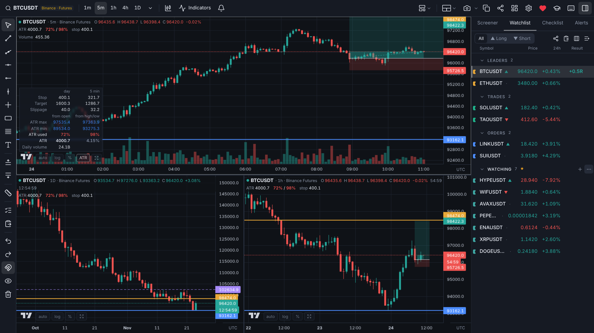
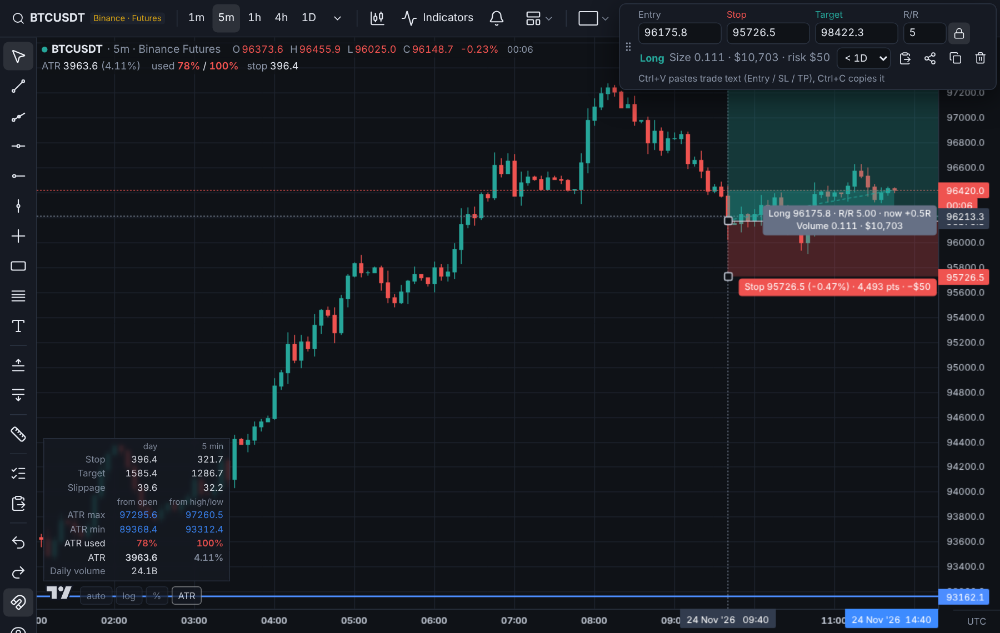
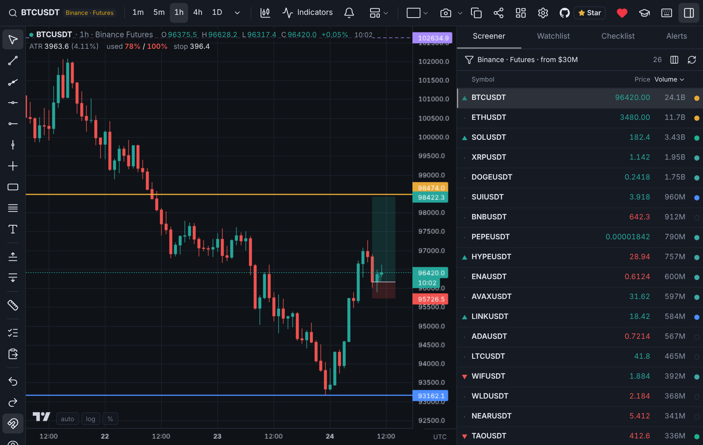
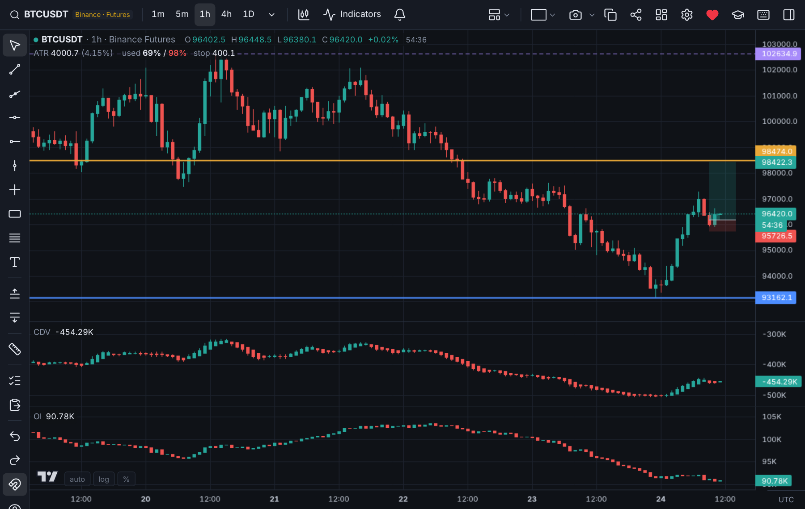
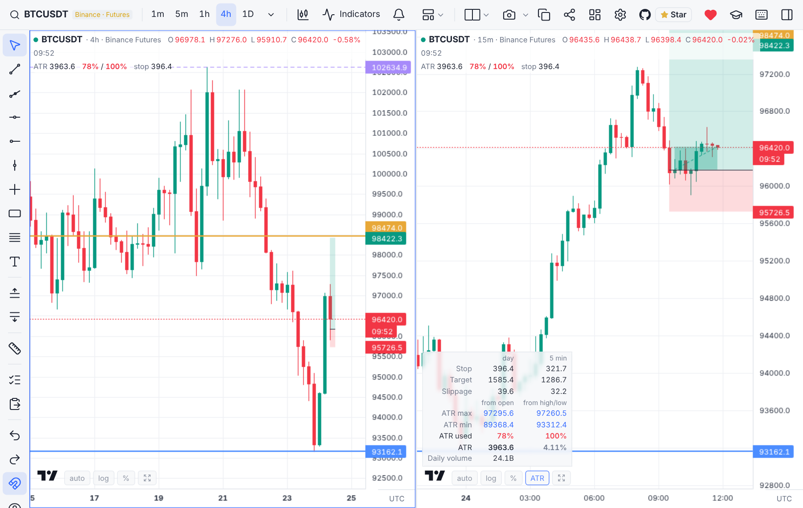
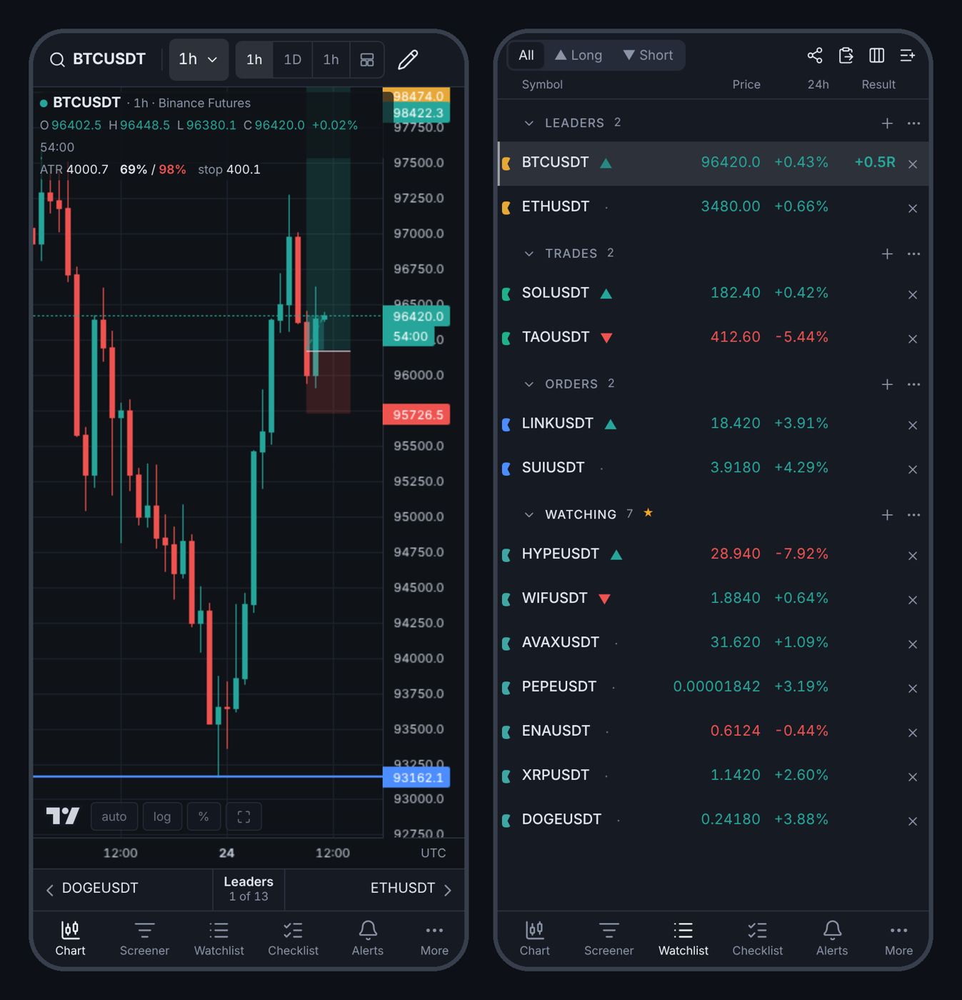
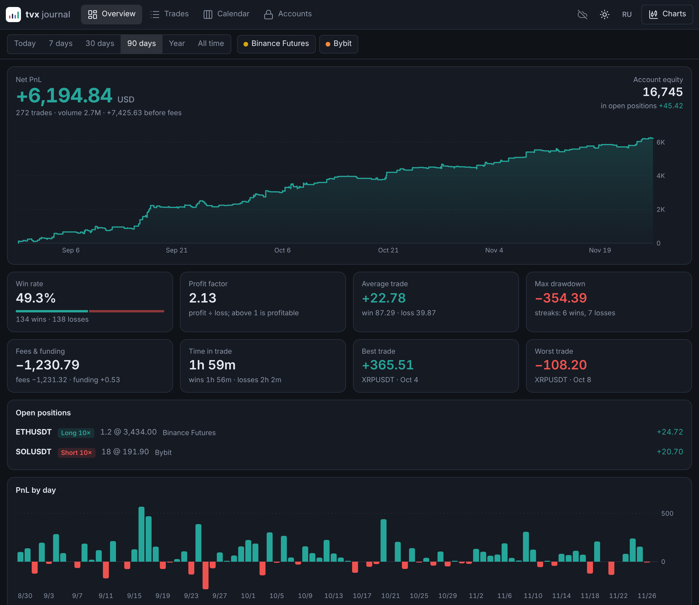

<div align="center">


# tvx — free trading terminal for Binance & Bybit

**Fast, TradingView-style charts in your browser. Multi-chart layouts, drawing tools, long/short positions,
ATR toolkit, screener, watchlists and alerts — no sign-up, no ads, no API keys.**

[](https://gurmanalexander.github.io/trading-platform/)

[](https://github.com/gurmanalexander/trading-platform/actions/workflows/pages.yml)


[](https://github.com/gurmanalexander/trading-platform/stargazers)

**English** · [Русский](README.ru.md)



</div>

## Why tvx

- **Free and private.** Everything runs in your browser and talks directly to public exchange APIs.
  No account, no server, no tracking. Your layouts, drawings and lists stay on your device.
- **Built for intraday traders.** Levels drawn on the daily chart show up on the 5-minute one,
  positions show live progress in R, the ATR table tells you stop, target and how much of the day's range is gone.
- **Lightweight.** About **210 KB** on first load — all JavaScript and CSS, gzipped; the whole app with every
  dialog is ~270 KB. Big web platforms usually download several megabytes of scripts before the first chart appears.
  No UI kits, no trackers, no backend — it opens instantly and runs smoothly even on an old phone.
- **Fast.** Canvas charts ([Lightweight Charts](https://github.com/tradingview/lightweight-charts)),
  one WebSocket per exchange, up to 8 synchronized charts on screen.
- **Works everywhere.** Desktop, tablet and phone; install it to your home screen as an app (PWA).
- **Two languages.** English and Russian, switchable any time. A short first-run setup picks the language,
  theme, time zone (your device's by default) and exchange.

## Features

<table>
<tr>
<td width="50%"></td>
<td width="50%"></td>
</tr>
<tr>
<td><b>Long / short positions.</b> Drag entry, stop and target or type them in — they snap to candle prices with the magnet (hold Shift to place freely). Lock the R/R (5:1 by default) and the target follows your stop. Live result in R, position size from your deposit and risk.</td>
<td><b>Screener & watchlists.</b> All Binance and Bybit symbols with turnover, 24h change and filters. Color-coded lists, long/short marks, distance to the nearest level in ATR.</td>
</tr>
<tr>
<td></td>
<td></td>
</tr>
<tr>
<td><b>Indicators.</b> Volume, SMA/EMA/WMA, Bollinger Bands, VWAP, RSI, MACD, Stochastic, ATR, Cumulative Delta Volume and Open Interest.</td>
<td><b>Dark & light themes</b>, custom colors, thin bars, time zones, bigger fonts for the scales and legend.</td>
</tr>
<tr>
<td colspan="2"></td>
</tr>
<tr>
<td colspan="2" align="center"><b>Made for phones too.</b> Install it to your home screen, swipe between coins, full-height landscape mode.</td>
</tr>
</table>

<details>
<summary><b>Full feature list</b></summary>

- **Market data:** Binance (spot, USDⓈ-M futures) and Bybit (spot, linear). History over REST, live updates over
  WebSocket, automatic reconnect and gap filling after sleep or network loss.
- **Layouts:** up to 8 charts, 16 presets plus custom rows/columns, resizable splits. Sync symbol, interval,
  crosshair and time between charts. Save layouts as templates and pin favorites to the top bar.
- **Charts:** bars, candles, hollow candles, Heikin Ashi, line, area; 13 intervals; normal, log, percent and inverted
  scales; grid and time labels continue into the future; last price colored by the last bar with a candle countdown;
  time zone selector (device time by default).
- **Drawing tools:** trend line, ray, horizontal line and ray, vertical line, cross, rectangle, Fibonacci, long/short
  position, text, freehand pencil (`Alt+B`), ruler (`Alt+M`). Magnet with off / weak / strong modes and a magnet crosshair (`Alt+Shift+M`)
  that snaps to candle OHLC. Per-timeframe visibility like TradingView (pick any set of timeframes, whole groups, or presets), undo/redo, copy/paste, keyboard nudging. Lines, shapes and
  the ruler also work in indicator panes (RSI, MACD, OI…), in the indicator's own values.
- **ATR toolkit:** daily ATR, how much of it is spent, stop / target / slack from daily and 5-minute ATR,
  daily range bounds.
- **Trade checklist** next to the chart, remembered per coin, can be pinned to the chart as a note.
- **Price alerts:** in-app, sound, vibration, browser notifications; drag the alert line on the chart.
- **Chart view on symbol change:** like TradingView, a new symbol keeps the zoom and position. Drag the chart in any
  direction (vertical drag turns off auto-scale). "Separate zoom for each symbol" in the View window remembers the view per symbol and interval.
- **Quick input:** start typing to search a symbol, type digits for an interval, paste a setup line
  like `10.11.2026 #1000PEPEUSDT Long 0.0053656` to open it with direction and level.
- **Share:** a link or QR code with levels and positions; share a whole watchlist as chart images to Telegram.
- **Device sync:** end-to-end encrypted, real-time sync of lists, drawings, alerts and settings between your devices
  via public Nostr relays — no account needed.
- **Mobile:** tabbed layouts, swipe between coins, full-height landscape mode, pull to refresh.

</details>

## Trading journal



**[tvx journal](https://gurmanalexander.github.io/trading-platform/journal/)** turns your Binance and Bybit futures
history into statistics — with no server and no sign-up, in the same spirit as the terminal.

- **What you see.** Net PnL and the cumulative curve, win rate, profit factor, average trade, max drawdown, fees and
  funding, best and worst trade, PnL by day / weekday / entry hour / holding time / coin / long vs short, a calendar,
  and the full list of trades with tags, notes and CSV export. Every trade opens on the tvx chart at its entry day.
- **How it connects.** Exchanges reject keyed requests sent straight from a web page, so the keys live in a small
  browser extension, **tvx bridge**. It signs read-only requests and hands the journal finished trades only.
- **Works in the background.** While the browser is open, the bridge loads new trades by itself every few minutes —
  the journal tab can stay closed. With sync on, it also sends them to your other devices.
- **Security.** The bridge accepts **read-only keys only** — it checks the key's permissions on the exchange and
  rejects one that can trade or withdraw; it has no order code at all. The secret is stored as a non-extractable
  signing key, keyed requests go to exchange hosts only, and the journal site never sees the keys.
- **Phone.** Trades, notes and account state sync end-to-end encrypted over the same Nostr relays (and the same sync
  code) as the terminal. The phone needs no extension and never receives the keys.
- **Supported now:** Binance USDⓈ-M Futures (the exchange serves the last 3 months), Bybit USDT/USDC perpetuals
  (2 years). Everything loaded stays in the journal for good.

Install the bridge from the journal's **Accounts** tab:

- **Chrome, Edge, Brave, Opera, Vivaldi, Yandex Browser:** download `tvx-bridge.zip`, unzip it, open
  `chrome://extensions`, turn on Developer mode and click **Load unpacked**.
- **Firefox:** download `tvx-bridge-firefox.zip`, open `about:debugging#/runtime/this-firefox` and click
  **Load Temporary Add-on**. It works until Firefox restarts — a permanent install needs the add-on signed by Mozilla.
  The Firefox build has not been tested in a real Firefox yet.
- **Safari:** no build — Apple accepts extensions only through Xcode and a paid developer account.

Want to look first? The journal has built-in demo data.

## Keyboard shortcuts

| Action | Keys |
| --- | --- |
| Search a symbol / change interval | start typing letters / digits (`5`, `15`, `1h`, `4h`, `D`) |
| Next / previous coin in the list | `↓` / `↑` |
| Horizontal line, trend line, pencil, ruler | `Alt+H`, `Alt+T`, `Alt+B`, `Alt+M` |
| Magnet crosshair | `Alt+Shift+M` |
| Add to watchlist, alert, checklist | `Alt+W`, `Alt+A`, `Alt+K` |
| Undo / redo, copy / paste drawing | `Ctrl+Z` / `Ctrl+Y`, `Ctrl+C` / `Ctrl+V` |
| All shortcuts | `Shift+/` |

## Run it yourself

The app is a static site: no backend, no environment variables. Requires Node.js 20+.

```bash
npm install
npm run dev        # http://localhost:5173
npm run build      # type check + production build into dist/ (terminal, journal, bridge extension)
npm test           # unit tests
npm run dev:journal            # the journal on http://localhost:5174
node scripts/e2e-bridge.mjs    # end-to-end check: extension + journal + a mock exchange in Chromium
```

`dist/` can be served by any static hosting (relative paths, works in a subfolder). HTTPS is needed
to install the app on a phone and for notifications. This repository deploys to GitHub Pages
automatically on every push to `main` (`.github/workflows/pages.yml`).

## Support the project

tvx is free and has no ads. If it helps your trading, you can support its development:
[open the donate window in the app](https://gurmanalexander.github.io/trading-platform/#donate) (QR codes, copy buttons)
or send USDT directly:

| Method | Address |
| --- | --- |
| Binance Pay (no fee) | [izi4ka](https://app.binance.com/uni-qr/LxreT8Gt) |
| USDT · TRC20 (Tron) | `TDiQ3qYR3nKasjs7v2Yvf4F9gtKCaApWMb` |
| USDT · BEP20 (BNB Smart Chain) | `0xdb91a73ce273e760cfed4b7ae39d73d7502419b6` |
| USDT · ERC20 (Ethereum) | `0xdb91a73ce273e760cfed4b7ae39d73d7502419b6` |

Send only USDT and only on the network shown — transfers on another network are lost.
**Not ready to donate? [Star the repository](https://github.com/gurmanalexander/trading-platform) ⭐** — it helps others find tvx.
Bug reports and feature ideas are very welcome too.

## Limitations

- tvx is an analysis and monitoring tool: **it does not place orders.** Positions are chart markup.
- Alerts fire while the app is open (a background tab is fine).
- Exchanges restrict access from some countries — the chart shows an error in that case.

## Tech

Vue 3 + TypeScript + Vite, [Lightweight Charts](https://github.com/tradingview/lightweight-charts),
icons by [Lucide](https://lucide.dev). The architecture, ATR formulas and sync protocol are described
in the [Russian README](README.ru.md).

```
src/
  exchanges/   Binance and Bybit adapters, shared WebSocket manager
  chart/       chart controller, drawings layer, positions
  lib/         indicators, ATR, intervals, formatting, i18n, parsing, sync
  stores/      app state: layouts, lists, screener, live prices, alerts, drawings
  components/  UI
  i18n/en/     English translations
journal/src/   trading journal: core (trades from fills, statistics), store, sync, views
extension/src/ tvx bridge: read-only exchange clients, key vault, options page
```
