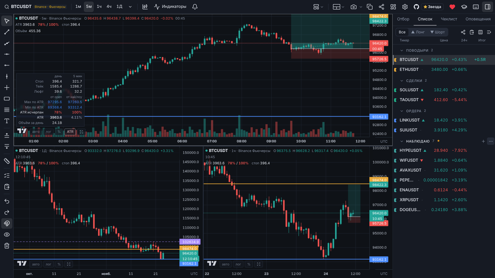
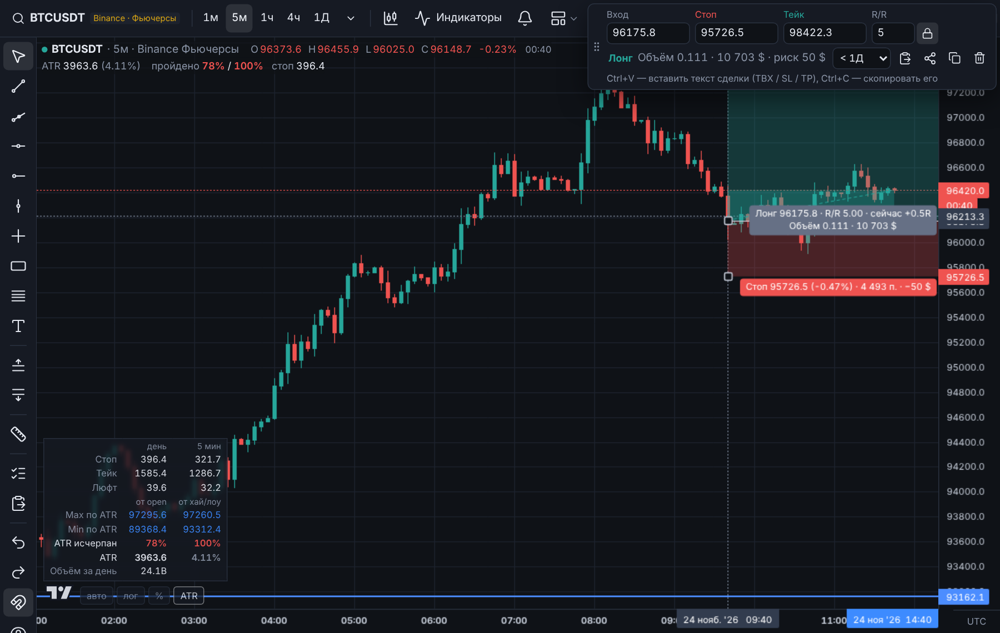
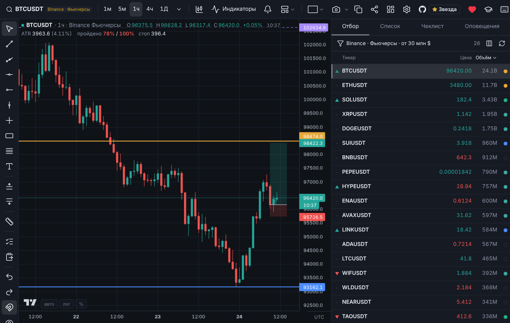
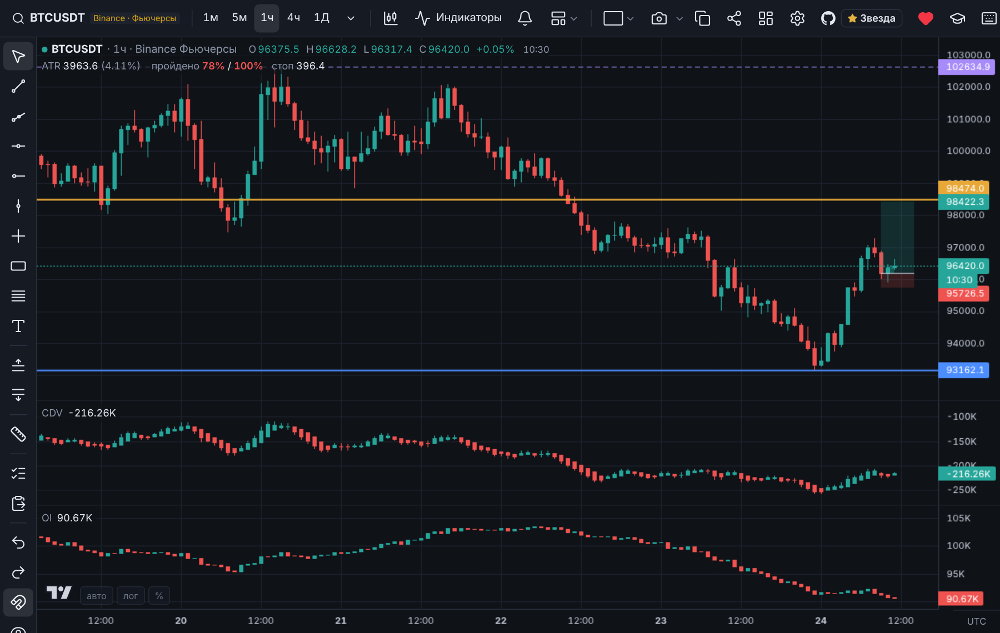
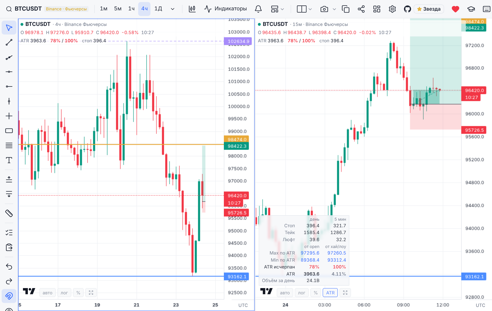
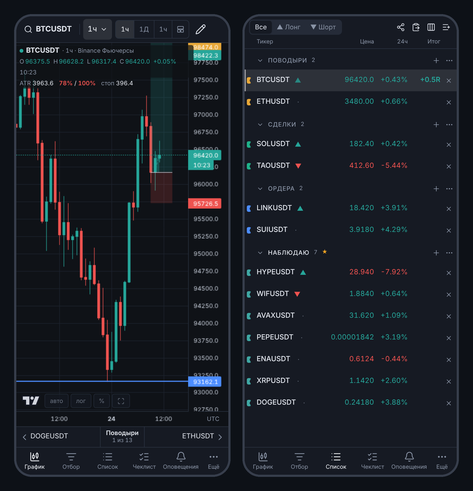
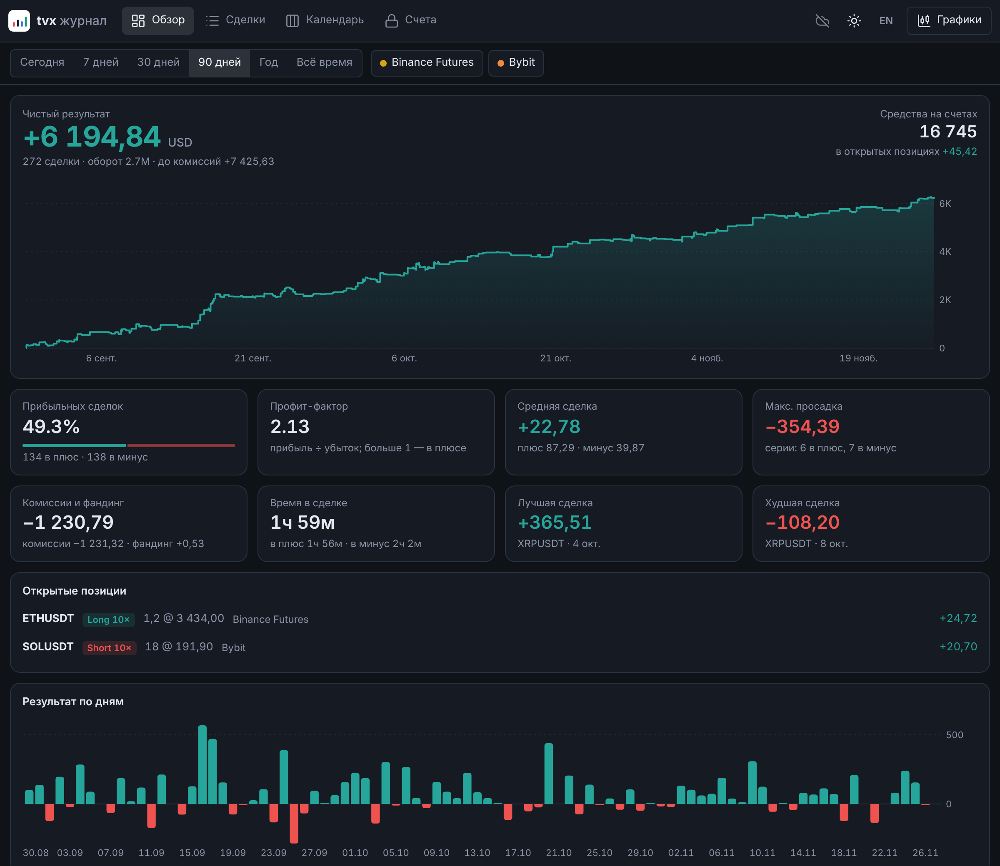

<div align="center">


# tvx — бесплатный торговый терминал для Binance и Bybit

**Быстрые графики в браузере, как в TradingView: несколько окон, рисование, позиции лонг/шорт,
ATR, отбор, списки и оповещения — без регистрации, без рекламы и без ключей API.**

[](https://gurmanalexander.github.io/trading-platform/)

[](https://github.com/gurmanalexander/trading-platform/actions/workflows/pages.yml)


[](https://github.com/gurmanalexander/trading-platform/stargazers)

[English](README.md) · **Русский**



</div>

## Почему tvx

- **Бесплатно и приватно.** Всё работает в браузере и обращается прямо к открытым API бирж.
  Ни аккаунта, ни сервера, ни слежки: раскладки, рисунки и списки остаются на вашем устройстве.
- **Лёгкий.** При первом открытии загружается около **210 КБ** — весь JavaScript и CSS в сжатом виде;
  всё приложение со всеми окнами — около 270 КБ. Веб-терминалы больших платформ обычно скачивают несколько
  мегабайт скриптов, прежде чем покажут первый график. Без UI-библиотек, трекеров и серверной части —
  открывается мгновенно и не тормозит даже на старом телефоне.
- **Для внутридневной торговли.** Уровень с дневного графика виден на пятиминутном, позиция показывает
  ход сделки в R, таблица ATR — стоп, тейк и сколько дневного хода уже пройдено.
- **Быстрый.** Графики на canvas ([Lightweight Charts](https://github.com/tradingview/lightweight-charts)),
  одно WebSocket-соединение на биржу, до 8 синхронных окон на экране.
- **Везде.** Компьютер, планшет и телефон; ставится на домашний экран как приложение (PWA).
- **Два языка.** Русский и английский, переключаются в любой момент. При первом запуске — короткая настройка:
  язык, тема, часовой пояс (по умолчанию — как на устройстве) и биржа.

## Как это выглядит

<table>
<tr>
<td width="50%"></td>
<td width="50%"></td>
</tr>
<tr>
<td><b>Позиции лонг и шорт.</b> Вход, стоп и тейк тянутся мышью или вводятся числами и притягиваются магнитом к ценам свечей (с Shift — без магнита). Привязка R/R (по умолчанию 5 к 1): тянешь стоп — тейк следует. Ход сделки в R, объём по депозиту и риску.</td>
<td><b>Отбор и списки.</b> Все монеты Binance и Bybit с оборотом, изменением за сутки и фильтрами. Цветные списки, отметки лонг/шорт, расстояние до ближайшего уровня в ATR.</td>
</tr>
<tr>
<td></td>
<td></td>
</tr>
<tr>
<td><b>Индикаторы.</b> Объём, SMA/EMA/WMA, полосы Боллинджера, VWAP, RSI, MACD, стохастик, ATR, Cumulative Delta Volume и открытый интерес.</td>
<td><b>Тёмная и светлая темы</b>, свои цвета, тонкие бары, часовые пояса, крупный шрифт шкал и легенды.</td>
</tr>
<tr>
<td colspan="2"></td>
</tr>
<tr>
<td colspan="2" align="center"><b>И на телефоне.</b> Ставится на домашний экран, монеты листаются смахиванием, телефон набок — график на весь экран.</td>
</tr>
</table>

## Поддержать проект

tvx бесплатный и без рекламы. Если он помогает вам в торговле — поддержите его развитие:
[окно доната в приложении](https://gurmanalexander.github.io/trading-platform/#donate) (QR-коды, кнопки «Скопировать»)
или переведите USDT напрямую:

| Способ | Адрес |
| --- | --- |
| Binance Pay (без комиссии) | [izi4ka](https://app.binance.com/uni-qr/LxreT8Gt) |
| USDT · TRC20 (Tron) | `TDiQ3qYR3nKasjs7v2Yvf4F9gtKCaApWMb` |
| USDT · BEP20 (BNB Smart Chain) | `0xdb91a73ce273e760cfed4b7ae39d73d7502419b6` |
| USDT · ERC20 (Ethereum) | `0xdb91a73ce273e760cfed4b7ae39d73d7502419b6` |

Отправляйте только USDT и только в указанной сети — перевод в другой сети не дойдёт.

**Не готовы донатить? [Поставьте звёздочку репозиторию](https://github.com/gurmanalexander/trading-platform) ⭐** —
так tvx легче найти другим трейдерам. Сообщения об ошибках и идеи тоже очень помогают.

## Все возможности подробно

- **Язык и первый запуск**: интерфейс на русском и английском, переключается в настройках (шестерёнка
  на верхней панели, на телефоне — «Ещё»). При первом запуске короткая настройка: язык, тема, часовой пояс
  (по умолчанию — как на устройстве), биржа и рынок. Стандартные списки и чеклист, если их не меняли,
  переходят на выбранный язык.
- **Данные**: Binance (спот, USDⓈ-M фьючерсы) и Bybit (спот, линейные контракты). История по REST,
  обновления по WebSocket, автоматическое переподключение и дозагрузка пропущенных свечей.
  После долгого простоя (приложение свёрнуто, устройство спало) данные догоняют время сами:
  соединения проверяются и создаются заново, графики дочитывают пропущенные свечи; на случай,
  если что-то всё же отстало, есть «Обновить данные» — см. раздел о телефоне.
- **Окна**: до 8 графиков на экране. 16 готовых раскладок и своя (ряды или колонки, до 4 окон в каждом);
  границы между окнами перетаскиваются, двойной щелчок по границе выравнивает доли, `Alt+Enter`
  разворачивает окно.
- **Синхронизация окон**: инструмент, интервал, перекрестие и время — включаются по отдельности.
  Рисунки привязаны к инструменту, поэтому уровень с дневного графика виден и на пятиминутном.
- **Шаблоны**: раскладка, интервалы, вид графиков, индикаторы и синхронизация окон сохраняются под именем.
  Избранные шаблоны (звёздочка) стоят кнопками на верхней панели — первая буква названия, переключение
  одним щелчком. Шаблон можно привязать к вкладке «Отбор» или «Список»: он включится сам, когда вкладку откроют.
- **График**: бары, свечи, пустые свечи, Хейкен Аши, линия, область; 13 интервалов, избранные выносятся
  на панель; обычная, логарифмическая, процентная и перевёрнутая шкала; колесо мыши над ценовой шкалой
  сжимает и растягивает график по вертикали; подгрузка истории при прокрутке; переход к дате; снимок в PNG.
  Сетка и подписи времени продолжаются правее последней свечи — в будущее, как в TradingView.
  Метка последней цены и линия цены — цветом последнего бара, под меткой — время до закрытия свечи.
  Линию текущей цены можно убрать (меню вида графика или «Шрифты, таймер, размер позиции») —
  цена и таймер на шкале останутся; по умолчанию линия видна.
  Тонкие бары (по умолчанию включены): при увеличении бар не толстеет — удобно смотреть хаи и лои;
  переключаются в меню вида графика и в «Шрифты, таймер, размер позиции».
  Часовой пояс — как в TradingView: кнопка в правом нижнем углу графика (под ценовой шкалой)
  или настройки вида; «как на устройстве», UTC или город. Пояс меняет время внутридневных графиков,
  дневные и старше подписаны датами биржи (UTC).
- **Рисование**: линия тренда, луч, горизонтальная линия и луч, вертикальная линия, перекрестие,
  прямоугольник, уровни Фибоначчи, длинная и короткая позиция, карандаш (рисование от руки, `Alt+B`), линейка.
  У линий настраиваются цвет, толщина, вид и подпись; стиль можно сделать стилем по умолчанию
  для инструмента. Цена уровней видна на ценовой шкале; у выбранного рисунка цены и время
  проецируются на обе шкалы. Маркеры, за которые тянут рисунок, — квадратные, как в TradingView.
  Выбранным может быть только один рисунок во всех окнах: щелчок по другому окну снимает выбор.
  Рисунок двигается стрелками, копируется перетаскиванием с `Ctrl`,
  для него задаётся видимость по интервалам, как в TradingView: каждый интервал отмечается отдельно
  (например, текст виден на 5м и 1ч, но не на 4ч), группой — минуты, часы, дни и старше — или готовым
  вариантом: все, внутри дня, от дня, только текущий. Видимость запоминается кнопкой «по умолчанию»
  вместе со стилем. Отмена и повтор, скрытие всех рисунков, магнит.
  Магнит, как в TradingView, — три режима (кнопка с магнитом на панели рисования): выключен; слабый —
  притягивает к открытию, хаю, лою или закрытию свечи с расстояния до 28 px (пальцем — до 40 px);
  сильный — всегда к ближайшей из этих цен. Перекрестие с магнитом (`Alt+Shift+M` или галочка в меню
  магнита): горизонтальная линия перекрестия притягивается к ценам свечи под курсором, и на шкале видна
  точная цена уровня — сила как у магнита, при выключенном магните — как у слабого. Линейка — `Alt+M`
  или `Shift+щелчок`, тоже с магнитом; показывает разницу в цене, процентах, пунктах, свечах, времени
  и в долях дневного ATR.
  Рисовать и мерить линейкой можно и в панелях индикаторов (RSI, MACD, стохастик, ATR, CDV, OI):
  точки там — в значениях индикатора, магнит притягивает к его линиям (не дальше слабого), подписи —
  на шкале индикатора. Такие рисунки привязаны к типу индикатора и видны в каждом окне инструмента,
  где он открыт; уровнями цены (список, дашборд, «поделиться») они не считаются. Позиции — только
  в области цены.
  Панель свойств рисунка лежит поверх всего приложения и может выходить за пределы своего графика —
  на соседний график, шкалы и боковую панель; граница — только окно браузера. Она перетаскивается
  за ручку слева и остаётся там, куда её поставили, для всех рисунков и графиков (двойное нажатие
  на ручку возвращает на место по умолчанию — у рисунка); в узком окне её кнопки переносятся
  на следующую строку. На сенсорном экране рисунок двигается, только когда он выбран: палец,
  опущенный на невыбранный рисунок, прокручивает график, а короткое касание выбирает рисунок.
  Выбранный рисунок важнее лежащих под ним линий: позицию, вход которой стоит прямо на уровне,
  можно тянуть за правый край и за линию входа — уровень эти нажатия не перехватывает.
- **Текст**: надписи на графике (цвет, размер, подложка; текст можно закрепить на экране, чтобы он
  не уезжал при прокрутке).
- **Чеклист сделки** — отдельная вкладка рядом с «Отбором» и «Списком» (`Alt+K`), на телефоне — раздел
  нижней панели. Блоки вопросов с вариантами заполняются рядом с графиком, отмеченное запоминается
  по монетам; внизу — монеты с заполненным чеклистом. Текст можно скопировать или держать заметкой
  на графике (галочка «на графике» — заметка обновляется при каждой отметке). Блоки настраиваются:
  вопросы, варианты, один или несколько ответов, показ блока по ответу в другом блоке.
- **Позиции лонг/шорт**: вход, стоп и цель вводятся числами или тянутся за маркеры; как и остальные
  рисунки, позиция ставится и тянется с магнитом (с зажатым `Shift` — без магнита);
  новая позиция получает стоп в 10% дневного ATR и цель по R/R из поля «R/R» (по умолчанию 5 к 1;
  вписанное значение запоминается для следующих позиций). Привязка R/R (замочек рядом с полем,
  по умолчанию включена): тянешь стоп или вход — тейк следует за ним, тянешь тейк — подтягивается стоп,
  соотношение остаётся прежним; то же при вводе цен числами. С выключенной привязкой стоп и тейк
  двигаются отдельно. Как в TradingView, сделка открывается
  на первой свече, коснувшейся цены входа, и учитывается только до правого края позиции. На графике
  виден ход сделки — где цена сейчас или где сделка закрылась — и результат в R. Если в настройках
  «Шрифты, таймер, размер позиции» задан депозит и риск на сделку в %, у позиции показывается объём
  (монеты и $) и сумма прибыли и убытка. У цели и стопа подписано расстояние от входа в процентах и в пунктах
  (шагах цены). Подписи видны только у позиции в фокусе — выбранной или под указателем. Цвета позиции — всегда зелёный и красный. По умолчанию позиции видны только
  на интервалах меньше дня. `Ctrl+C` копирует позицию текстом, `Ctrl+V` раскладывает текст сделки
  (`ТВХ / SL / TP`) по выбранной позиции или создаёт новую.
- **ATR** — по формулам индикатора «Trader Assistant» (см. ниже): в легенде графика — ATR, насколько он
  исчерпан и размер стопа; на интервалах до 15 минут — таблица: стоп, тейк и люфт по дневному ATR и по
  ATR пятиминутки, границы дня (Max/Min по ATR), исчерпание от открытия и по размаху, объём за день.
- **Индикаторы**: объём, SMA, EMA, WMA, полосы Боллинджера, VWAP, RSI, MACD, стохастик, ATR,
  Cumulative Delta Volume (CDV) и открытый интерес.
  CDV считается как одноимённый индикатор TradingView (LonesomeTheBlue): объём свечи делится на
  покупки и продажи по соотношению тела и теней, дельта копится с первой загруженной свечи; свечи
  Хейкен Аши по умолчанию (снимаются в настройках индикатора). Открытый интерес — только у фьючерсов,
  свечами (открытие — интерес на закрытии прошлой свечи), обновляется раз в минуту; у Binance история
  интереса — не глубже 30 дней, шаг не мельче 5 минут.
- **Отбор**: инструменты биржи; условия (биржа, рынок, оборот, изменение цены, валюта котировки, сортировка)
  задаются в отдельном окне. Токенизированные акции и прочее TradFi (сырьё, валюты, доли до IPO) отделены
  от криптовалют по данным самих бирж: по умолчанию в отборе только криптовалюты, «Что показывать»
  переключает на акции или на всё вместе. На споте Binance биржа акции не помечает — там разделения нет. Столбцы настраиваются (по умолчанию тикер, цена, объём), цена окрашена
  по изменению за сутки. По умолчанию — фьючерсы Binance с оборотом от 30 млн $ по убыванию оборота.
- **Списки наблюдения**: все списки одним потоком, заголовки-разделы с цветной меткой, сворачиваются;
  списки и инструменты перетаскиваются (на сенсорном экране — после долгого нажатия). Столбцы
  настраиваются (по умолчанию тикер, цена, итог): итог — результат идущей сделки в R, а если сделки
  нет — расстояние до ближайшего уровня в ATR. Новый список создаётся строкой прямо в панели.
  Цены идут из потока биржи; если поток по монете замолчал дольше 12 секунд, цена дочитывается
  по REST, а при расхождении подписка на монету делается заново — котировки не «застывают».
- **Направление и списки из отбора**: отметка лонг/шорт — свойство монеты, она одна и та же
  в отборе, поиске и всех списках и ставится щелчком по значку слева от названия. Точка в строке
  отбора показывает, в каких списках монета, и открывает их выбор. Несколько монет сразу:
  `Ctrl`+щелчок выбирает по одной, `Shift`+щелчок — подряд (на сенсорном экране — долгое нажатие,
  дальше касания); точка любой выбранной строки, кнопка «В список» или меню по правой кнопке
  добавляют в список и ставят направление всем выбранным. Фильтр «лонг» прячет только
  шорты (и наоборот): неотмеченные монеты видны всегда.
- **Обзор** (`Alt+D`): сводка по монетам списков — сделки и их результат, монеты у уровней, исчерпание
  ATR, движение за сутки, сработавшие оповещения, итоги отбора.
- **Вид графика при смене монеты**: как в TradingView — новая монета встаёт в том же масштабе и на том же
  месте. График тянется мышью во все стороны (по вертикали — с выключением автомасштаба), «Авто» сбрасывает.
  Галочка «Свой масштаб у каждой монеты» в окне «Вид» запоминает вид для каждой монеты и интервала.
- **Поиск** по всем инструментам обеих бирж.
- **Оповещения о цене**: сообщение, звук, вибрация, уведомление браузера. Линию оповещения можно тянуть
  по графику; непрочитанные считаются на вкладке и колокольчике; есть действия со всеми сразу.
- **Быстрый ввод**: начните печатать название — откроется поиск по инструментам (цифры открывают ввод
  интервала). Строку вида `10.11.2026 #1000PEPEUSDT Long 0,0053656` можно просто вставить (`Ctrl+V`
  или кнопка «Вставить»): откроется монета, поставится направление и уровень, графики сдвинутся к дате —
  на дневном дата в правой трети, на часовом начало дня посередине, на минутных — в левой трети.
  Дата, уровень, направление и решётка необязательны; уже существующий уровень не трогается.
  Вставленная монета попадает в конец текущего списка (★); можно вставить сразу несколько строк.
  Монета, которая уже лежит в любом списке, повторно не добавляется — ей только ставятся направление
  и уровень. Лишние слова в строке не мешают, непонятные строки пропускаются с сообщением.
  Биржа по умолчанию для таких строк (Binance, фьючерсы) меняется в настройках.
- **Поделиться**: три ближайших к цене уровня и три последние позиции — отмечаете нужное и получаете
  ссылку, QR-код или текст для мессенджера. Строку сетапа можно дописать и прямо к адресу:
  `…/trading-platform/10.11.2026 #1000PEPEUSDT Long 0,0053656` — всё откроется и нарисуется.
- **Поделиться списком**: кнопка в «Списке» открывает окно с монетами всех списков. Отмечаете нужные —
  по каждой готовится картинка со всеми окнами раскладки (те же интервалы, индикаторы, рисунки,
  запомненный вид монеты) и строка «#BNBUSDT Short 677,76»: монета, направление, ближайший к цене
  уровень. У каждого списка есть переключатель «по умолчанию»: монеты такого списка отмечены сразу,
  остальных — вручную (сначала так отмечены все списки). Готовое уходит в Telegram, WhatsApp и другие
  приложения системной кнопкой «Отправить» — картинки файлами, список подписью; он же копируется
  в буфер. Telegram подпись к нескольким картинкам не принимает (к одной — принимает), поэтому
  рядом есть «Отправить список» — вторым сообщением в тот же чат. Где браузер не умеет передавать файлы, картинки сохраняются файлами или копируются
  по одной нажатием. Графики на экране при этом не переключаются. Строки списка понимает
  вставка сетапов, так что получатель с tvx может вставить их к себе.
- **Снимки**: кнопка сразу сохраняет PNG активного окна; в стрелке рядом — все окна одной картинкой.
- **Цвета**: в тёмной теме выбранное и фокус — светлым, без синего на чёрном; тема как в системе, тёмная или светлая; цвета растущих и падающих свечей, фона, сетки,
  текста и акцента настраиваются отдельно для каждой темы. Цвет свечей не меняет цифры интерфейса,
  позиции и линейку: рост и прибыль — всегда зелёные, падение и убыток — красные.
- **Крупный шрифт и таймер свечи**: в настройках «Шрифты, таймер, размер позиции» — размер шрифта шкал
  (и подписей рисунков) и легенды с ATR; время до закрытия свечи показывается на шкале цены под последней ценой.
- **Синхронизация устройств в реальном времени**: списки, отметки, уровни и остальные рисунки, оповещения,
  чеклист, шаблоны и общие настройки одинаковы на всех устройствах, изменения появляются на другом
  устройстве примерно за секунду. Подключение — ссылкой или QR-кодом (см. ниже «Как устроена синхронизация»).
- **Разовый перенос**: то же самое ссылкой, QR-кодом или файлом, без постоянной связи — с объединением
  или полной заменой данных на принимающем устройстве.
- **Обучение**: кнопка на верхней панели открывает видео-обзор терминала с оглавлением по частям и субтитрами
  (файлы лежат в `public/help`).
- **GitHub**: кнопка со счётчиком звёзд на верхней панели (на телефоне — «Ещё» → «Звезда на GitHub») ведёт
  в репозиторий — там можно поставить звёздочку.
- **Поддержать проект**: сердечко на верхней панели (на телефоне — «Ещё» → «Поддержать проект») открывает
  окно доната: сначала выбирают способ (Binance Pay, USDT TRC20, BEP20 или ERC20), потом видят только его —
  адрес, кнопку «Скопировать» и предупреждение про сеть; QR-код — у выбранного способа (на телефоне — по кнопке).
  Сердечко красное, залитое; время от времени оно «стучит» — два удара со свечением и два расходящихся кольца: первый раз через
  20 секунд после запуска, потом раз в полторы минуты; когда окно доната уже открывали — раз в 15 минут.
- **Телефон**: окна шаблона переключаются вкладками, кнопка рядом показывает все окна сразу; режим
  «только график» убирает панели; вставка сделки и сетапов из буфера — кнопкой. Полоса под графиком
  листает монеты списка; повёрнутый набок телефон отдаёт графику всю высоту экрана; разделы
  обновляются жестом «потянуть вниз».

## Журнал сделок



**[Журнал tvx](https://gurmanalexander.github.io/trading-platform/journal/)** превращает историю ваших фьючерсных сделок
на Binance и Bybit в статистику — без сервера и регистрации, как и сам терминал.

- **Что видно.** Чистый результат и кривая накопленного итога, доля прибыльных сделок, профит-фактор, средняя сделка,
  максимальная просадка, комиссии и фандинг, лучшая и худшая сделка; результат по дням, дням недели, часу входа,
  времени удержания, монетам, лонгу и шорту; календарь; список сделок с метками, заметками и выгрузкой в CSV.
  Любая сделка открывается на графике tvx в день входа.
- **Как подключается.** Биржи не принимают запросы с ключом прямо со страницы сайта, поэтому ключи держит небольшое
  расширение браузера — **tvx bridge** («мост»). Оно подписывает запросы на чтение и отдаёт журналу готовые сделки.
- **Работает в фоне.** Пока браузер открыт, мост сам догружает новые сделки каждые несколько минут — вкладку журнала
  держать открытой не нужно. Если включена синхронизация, он же отправляет их на остальные ваши устройства.
  Браузер может остановить фоновую часть расширения в любой момент, поэтому место остановки запоминается и загрузка
  продолжается с него.
- **Безопасность.** Мост принимает **только ключи «только чтение»**: права ключа проверяются на бирже, и ключ, которым
  можно торговать или выводить средства, отклоняется; кода для ордеров в расширении нет. Секрет хранится как
  не извлекаемый ключ подписи (им можно подписать запрос, но прочитать обратно нельзя). Запросы с ключом уходят
  только на адреса бирж; на ретрансляторы синхронизации мост передаёт только зашифрованные сделки. Сайт журнала
  ключей не видит.
- **Телефон.** Сделки, пометки и состояние счетов синхронизируются в зашифрованном виде через те же ретрансляторы
  Nostr и тем же кодом, что и терминал. На телефоне расширение не нужно, ключи туда не попадают.
- **Что поддерживается.** Binance USDⓈ-M Futures (биржа отдаёт историю за 3 месяца) и бессрочные контракты Bybit
  в USDT и USDC (за 2 года). Всё загруженное остаётся в журнале навсегда.

Установка моста — со вкладки журнала «Счета»:

- **Chrome, Edge, Brave, Opera, Vivaldi, Яндекс Браузер:** скачайте `tvx-bridge.zip`, распакуйте, откройте
  `chrome://extensions`, включите «Режим разработчика» и нажмите «Загрузить распакованное расширение».
- **Firefox:** скачайте `tvx-bridge-firefox.zip`, откройте `about:debugging#/runtime/this-firefox` и нажмите
  «Загрузить временное дополнение». Так оно работает до перезапуска Firefox: для постоянной установки дополнение
  нужно подписать у Mozilla. В настоящем Firefox сборка ещё не проверялась.
- **Safari:** сборки нет — Apple принимает расширения только через Xcode и платную учётную запись разработчика.

Хотите сначала посмотреть — в журнале есть демо-данные.

Как устроено внутри:

- `journal/src/core` — сборка сделок из исполнений (позиция «от нуля до нуля», режим хеджирования, перевороты,
  фандинг) и статистика; чистые функции с тестами.
- `extension/src` — клиенты бирж (только запросы на чтение), хранилище ключей, фоновая загрузка истории
  (`history.ts`) и выгрузка для других устройств (`publish.ts`), страница добавления ключей. Сайт спрашивает у моста
  готовое: счета, ход загрузки, сделки (`journal/src/core/protocol.ts`); запросов, меняющих что-либо на бирже
  или отдающих ключи, в протоколе нет.
- Проверка без настоящих ключей: `scripts/mock-exchange.mjs` — учебная «биржа», которая отвечает как Binance и Bybit
  и так же проверяет подписи; `node scripts/e2e-bridge.mjs --sync` прогоняет в настоящем Chromium расширение, журнал,
  синхронизацию на второе устройство и доставку свежей сделки при закрытом журнале.

## Запуск

Нужен Node.js 20+.

```bash
npm install
npm run dev        # режим разработки: http://localhost:5173
npm run build      # проверка типов и сборка в dist/
npm run preview    # посмотреть собранную версию
npm test           # модульные тесты
```

## Размещение

`dist/` — обычные статические файлы, их можно положить на любой хостинг или свой сервер
(пути относительные, подойдёт и подпапка). Для установки на телефон и уведомлений нужен HTTPS.

### GitHub Pages

В репозитории есть workflow `.github/workflows/pages.yml`: на каждый push он запускает тесты и сборку,
а с основной ветки репозитория (`main`) ещё и публикует `dist/` на GitHub Pages.

Включается один раз: **Settings → Pages → Build and deployment → Source: GitHub Actions**.
После этого сайт появится по адресу `https://<пользователь>.github.io/<репозиторий>/`.
Публикацию можно запустить и вручную: **Actions → нужный workflow → Run workflow** — опубликуется выбранная ветка.

Если публикация падает сразу, не дойдя до запуска, ветке не разрешено публиковать: добавьте её в
**Settings → Environments → github-pages → Deployment branches and tags**.

Сайт на Pages открыт всем, у кого есть ссылка, даже если репозиторий приватный
(а для приватного репозитория Pages доступен только на платном тарифе GitHub).

**На телефоне**: откройте адрес в браузере → «Добавить на главный экран» (iOS: «Поделиться» → «На экран „Домой“»).

- Окна раскладки переключаются вкладками на верхней панели (подпись вкладки — интервал окна).
  В меню «Ещё» есть режим «Показывать все окна сразу»: окна встают столбцом, а на повёрнутом
  телефоне — в ряд; границы между ними перетаскиваются.
- Меню «Ещё» стоит в нижней навигации и открывается из любого раздела. В нём всё, что на широком
  экране лежит кнопками: индикаторы, вид графика, раскладки, шаблоны, синхронизация, чеклист,
  сделка текстом, тема.
- На экране одно окно раскладки, и оно всегда занимает всё место под график — даже если на
  компьютере границы окон в этом шаблоне сдвинуты.
- Панель свойств выбранного рисунка встаёт внизу графика, а не поверх рисунка.
- **Листание монет.** Под графиком — полоса: слева и справа соседние монеты того списка, из которого
  открыт график («Отбор» или «Список» — что открывали последним), посередине — название списка и
  место монеты в нём. Нажатие на соседнюю монету или смахивание по полосе открывает её, нажатие
  посередине — сам список.
- **Разделы без лишнего.** В «Отборе», «Списке», «Чеклисте» и «Оповещениях» верхней панели нет:
  она управляет графиком и видна только на нём.
- **Телефон набок.** Верхняя панель и нижняя навигация собираются в узкую колонку слева, и график
  занимает всю высоту экрана. Поиск монеты — нажатием на её название в подписи графика; монеты
  списка листают кнопки «‹» «›» внизу графика (они же есть в режиме «только график»).
- **Обновление.** В любом разделе потяните список вниз — соединения с биржей создаются заново,
  графики, отбор и дневные показатели запрашиваются снова. То же делает «Обновить данные» в меню «Ещё»;
  там же — «Перезапустить приложение».
- Панель рисования открывается карандашом и лежит полосой под графиком; в ней же отмена и повтор.
- «Сделка текстом» заменяет `Ctrl+V`: текст вставляется в поле или берётся из буфера кнопкой.

### Свой сервер

Пример для nginx:

```nginx
server {
    listen 443 ssl;
    server_name terminal.example.com;
    root /var/www/tvx/dist;

    location / {
        try_files $uri /index.html;
    }
    location /assets/ {
        add_header Cache-Control "public, max-age=31536000, immutable";
    }
    location = /sw.js {
        add_header Cache-Control "no-cache";
    }
}
```

## Горячие клавиши

Полный список с поиском открывается кнопкой с клавиатурой на верхней панели или клавишами `Shift+/`.

| Действие | Клавиши |
| --- | --- |
| Поиск инструмента | начните печатать буквы |
| Интервал | наберите цифры: `5`, `15`, `1h`, `4h`, `D`, `W` |
| Следующий / предыдущий инструмент открытого списка или отбора | `↓` / `↑`, а также `Пробел` / `Shift+Пробел` |
| Добавить график в текущий список | `Alt+W` |
| Оповещение | `Alt+A` |
| Чеклист сделки, обзор по спискам | `Alt+K`, `Alt+D` |
| Индикаторы | `/` |
| Сдвиг и масштаб | `←` `→` (с `Ctrl` — на 20 свечей), `+` `−` (или `Ctrl+↑` `Ctrl+↓`), `End` — к текущей цене |
| Сброс масштаба, лог-, процентная, перевёрнутая шкала | `Alt+R`, `Alt+L`, `Alt+P`, `Alt+I` |
| Перейти к дате, снимок графика | `Alt+G`, `Alt+S` |
| Следующее окно, развернуть окно, весь экран | `Tab`, `Alt+Enter`, `Shift+F` |
| Тренд, горизонталь, гор. луч, вертикаль, перекрестие, Фибоначчи, прямоугольник, карандаш | `Alt+T`, `Alt+H`, `Alt+J`, `Alt+V`, `Alt+C`, `Alt+F`, `Alt+Shift+R`, `Alt+B` |
| Линейка, перекрестие с магнитом | `Alt+M` или `Shift`+щелчок, `Alt+Shift+M` |
| Отменить / вернуть, копировать / вставить рисунок | `Ctrl+Z` / `Ctrl+Y`, `Ctrl+C` / `Ctrl+V` |
| Сдвинуть выбранный рисунок, скопировать | стрелки (с `Shift` — ×10), перетаскивание с `Ctrl` |
| Вставить текст сделки в позицию | `Ctrl+V` |
| Удалить рисунок, скрыть все рисунки | `Delete`, `Ctrl+Alt+H` |

## Как считается ATR

Формулы и значения по умолчанию взяты из индикатора «Trader Assistant» (`src/lib/atr.ts`):

- **ATR** — среднее диапазонов (high − low) пяти предыдущих завершённых дневных свечей; текущий день
  не участвует. Одно и то же значение используется в легенде, таблице, списках и обзоре.
- **Стоп** — 10% ATR, **тейк** — 4 стопа, **люфт** — 10% стопа.
- **По пятиминуткам**: стоп — два ATR(30) пятиминутного графика, тейк и люфт — в тех же пропорциях.
- **ATR исчерпан**: от открытия дня до текущей цены и по размаху дня (максимум − минимум).
  Меньше 30% — запас хода, больше 70% — ход на исходе.
- **Max / Min по ATR**: открытие ± ATR и минимум + ATR / максимум − ATR.

В индикаторе объявлены параметры фильтра «не более 150% / не менее 50%», но в его расчёте они
не используются — здесь их тоже нет.

## Как устроена синхронизация

Своего сервера у приложения нет. При включении создаётся случайный код; из него выводятся ключ
шифрования и ключ подписи. Каждое изменение шифруется на устройстве (AES-GCM) и публикуется
на публичных ретрансляторах протокола Nostr: они хранят последнюю версию каждого «документа»
(списки, оповещения, чеклист, настройки, рисунки каждой монеты отдельно) и сразу рассылают её
остальным устройствам с тем же кодом. Ретранслятор видит только шифртекст.

- Если одно и то же изменили на двух устройствах одновременно, остаётся более позднее изменение документа.
- Правки без связи уходят, когда связь появляется; устройство, включённое позже, забирает последние версии.
- Открытая монета, раскладка окон, тема и столбцы таблиц у каждого устройства свои.
- Ссылка подключения — ключ к данным: кто её получил, может их читать и менять.
- Список ретрансляторов меняется в окне синхронизации; работа зависит от их доступности.

## Почему это быстро

- При первом открытии загружается около 210 КБ (весь JavaScript и CSS, сжатый gzip), всё приложение — около 270 КБ:
  редкие окна (настройки, синхронизация, обзор и т. п.) подгружаются, только когда их открывают; видео-обзор — тоже.
- Графики — [Lightweight Charts](https://github.com/tradingview/lightweight-charts) (canvas), интерфейс — Vue 3
  без UI-библиотек.
- Одно WebSocket-соединение на биржу и рынок; подписки считаются по ссылкам, неиспользуемые закрываются.
  Тему, которую биржа однажды отклонила, через минуту и при новом соединении просим снова.
- Цены попадают в интерфейс пачками несколько раз в секунду, индикаторы на тике обновляют только последнюю точку.
- Отбор обновляется раз в 20 секунд и только пока он на экране; на телефоне создаётся только видимое окно.
- Дневные свечи для ATR запрашиваются по одному разу на инструмент и обновляются раз в 10 минут.

## Устройство

```
src/
  exchanges/   адаптеры бирж (binance.ts, bybit.ts) и общий WebSocket-менеджер (ws.ts)
  chart/       контроллер графика, слой рисунков, расчёт позиций, цвета тем
  lib/         индикаторы, ATR, интервалы, форматирование, хранилище, разбор вставляемых строк, перенос и синхронизация
  stores/      состояние: раскладка и шаблоны, списки, отбор, живые цены, оповещения, рисунки, синхронизация
  components/  интерфейс
public/        манифест, значки, service worker
tests/         модульные тесты
```

Новая биржа добавляется реализацией интерфейса `ExchangeAdapter` (`src/exchanges/types.ts`)
и регистрацией в `src/exchanges/index.ts`.

## Ограничения

- Это терминал для анализа и наблюдения: **выставление ордеров не реализовано**. Позиции лонг/шорт —
  инструмент разметки графика, а не заявки. Ход сделки оценивается по свечам: если одна свеча
  задела и стоп, и цель, считается стоп. Для торговли нужны ключи API, а хранить их в браузере
  небезопасно — потребуется серверная часть.
- Оповещения срабатывают, пока приложение открыто (вкладка может быть в фоне). Телефон усыпляет фоновые
  вкладки, поэтому надёжные оповещения при закрытом приложении тоже требуют сервера.
- Синхронизация устройств идёт через сторонние публичные ретрансляторы: если они недоступны, изменения
  дойдут позже. Данные зашифрованы, но ссылку подключения нужно держать при себе.
- Биржи ограничивают доступ из некоторых стран; в этом случае на графике будет сообщение об ошибке.
- Точность цены определяется по самим котировкам, а не по спецификации инструмента.

Значки интерфейса — [Lucide](https://lucide.dev) (лицензия ISC); набор собирается скриптом `scripts/gen-icons.mjs`.
